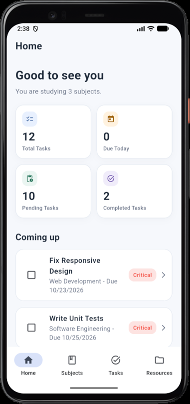
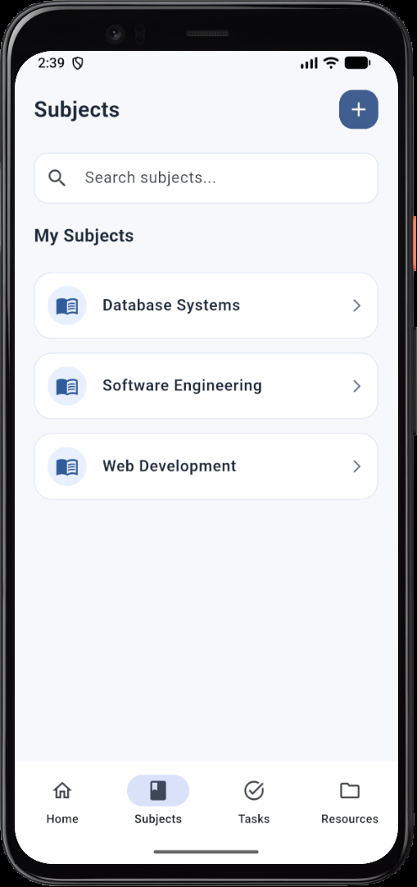
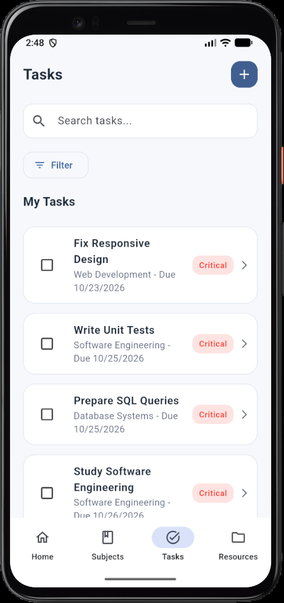
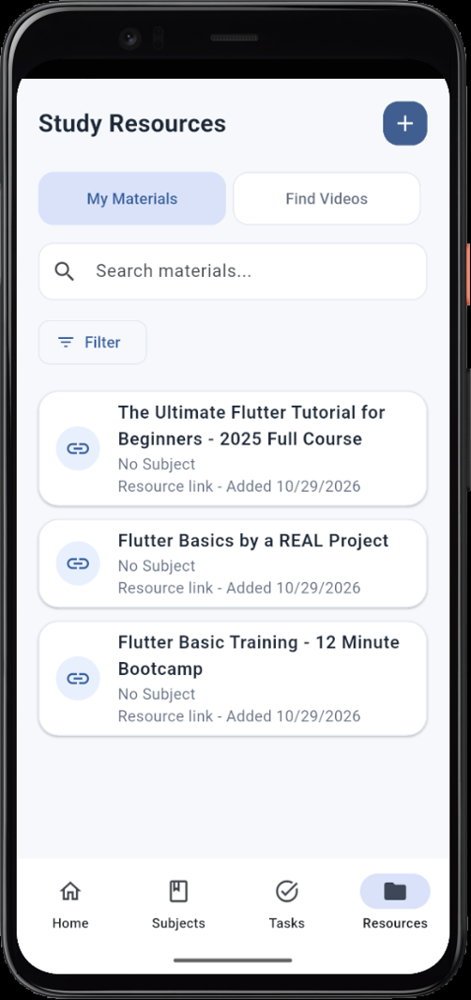
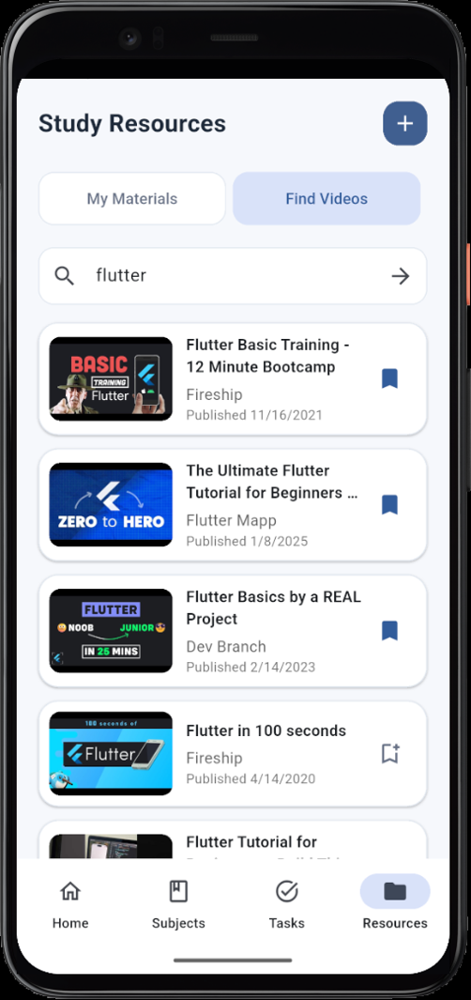
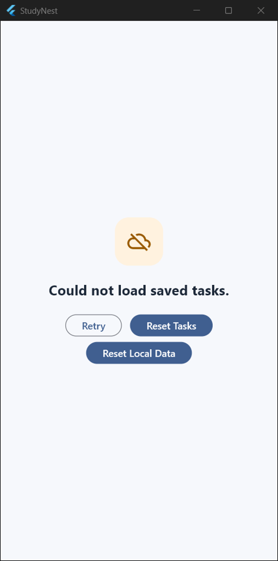
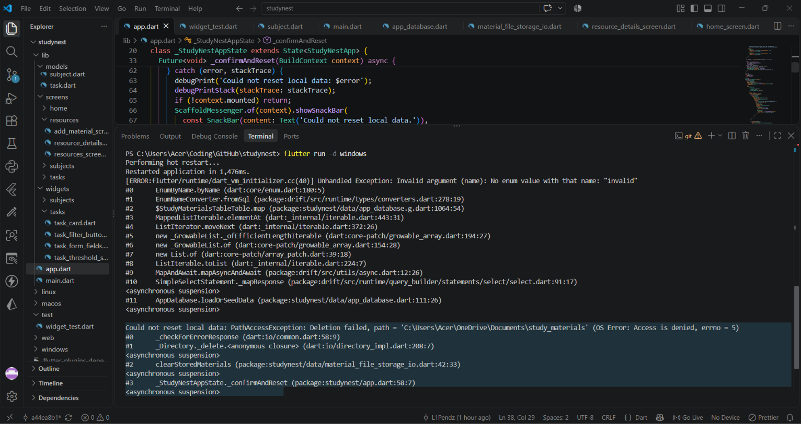
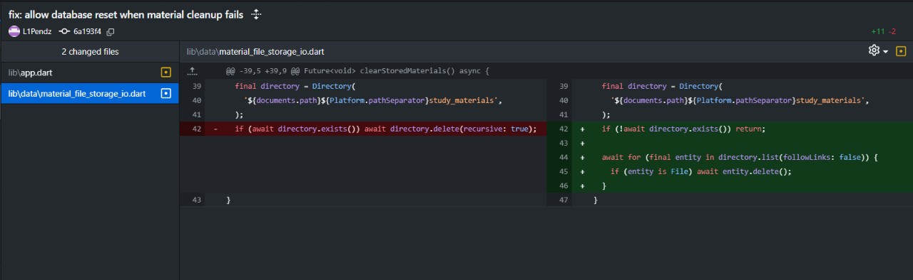

# StudyNest

StudyNest is a Flutter study planner that helps students organize subjects, assignments, deadlines, and study resources in one place. It stores planner data locally and includes YouTube search for educational videos.

## Features

- Create and manage subjects.
- Create, edit, filter, and complete tasks with due dates and priority thresholds.
- Attach study materials to subjects, including documents and links.
- Save selected document files in the app's local storage and open them later.
- Search YouTube for educational videos and save videos as study resources.
- Reset all local data or reset subjects, tasks, or materials separately.
- Recover from saved-data loading errors with retry and reset options.

## Screenshots

A look at StudyNest's planner and study resources.

| Home dashboard | Subjects |
| --- | --- |
|  |  |

| Task list | Study resources |
| --- | --- |
|  |  |

| YouTube video search | Saved-data recovery |
| --- | --- |
|  |  |

More screenshots, including subject details and task and material forms, are available in [`docs/screenshots`](docs/screenshots/).

## Packages and technologies

- **Flutter / Dart** — cross-platform application framework and language.
- **drift** — typed SQLite database layer.
- **drift_flutter** — Flutter integration for Drift databases.
- **path_provider** — access to application storage directories.
- **file_picker** — select study files from the device.
- **open_filex** — open local documents.
- **url_launcher** — open links and YouTube videos.
- **http** — make YouTube Data API requests.
- **cupertino_icons** — Cupertino-style icons.
- **build_runner** and **drift_dev** — generate Drift database code (development).
- **flutter_test** and **flutter_lints** — testing and linting (development).

## Requirements

- Flutter SDK compatible with pubspec.yaml (Dart 3.10.3 or newer).
- Android Studio or another configured Android toolchain to build Android APKs.
- A deployed Cloudflare Worker that proxies YouTube search. The rest of the planner works without it.

## Setup and run

From the repository root:

~~~powershell
flutter pub get
flutter run
~~~

To enable YouTube search, deploy the Cloudflare Worker described in the API key handling section below, then provide its HTTPS URL:

~~~powershell
flutter run --dart-define=YOUTUBE_SEARCH_WORKER_URL=https://your-worker.your-subdomain.workers.dev
~~~

Build a release APK with YouTube search enabled:

~~~powershell
flutter build apk --release --dart-define=YOUTUBE_SEARCH_WORKER_URL=https://your-worker.your-subdomain.workers.dev
~~~

The APK is generated at build/app/outputs/flutter-apk/app-release.apk.

### YouTube API and Cloudflare Worker setup

YouTube search requires a YouTube Data API v3 key and a deployed Cloudflare Worker. The key is stored by Cloudflare and never added to the Flutter app.

1. In [Google Cloud Console](https://console.cloud.google.com/), create or select a project and enable **YouTube Data API v3** from **APIs & Services → Library**.
2. Go to **APIs & Services → Credentials → Create credentials → API key**. Restrict the key to **YouTube Data API v3** under **API restrictions**, then save it. Do not commit the key or put it in a Flutter `--dart-define`.
3. Create and deploy a Cloudflare Worker. It must accept `GET /search?q=...`, call YouTube's `search.list` endpoint with the key, and return the YouTube JSON response. For Flutter Web, configure the Worker to return CORS headers that allow your app's origin.
4. In the Cloudflare dashboard, open the Worker and go to **Settings → Variables and Secrets**. Add a **Secret** named `YOUTUBE_API_KEY` with the key from Google Cloud, then save and deploy the Worker.
5. Copy the Worker base URL (without `/search`) and pass it when running or building the app:

~~~powershell
flutter run --dart-define=YOUTUBE_SEARCH_WORKER_URL=https://your-worker.your-subdomain.workers.dev
flutter build apk --release --dart-define=YOUTUBE_SEARCH_WORKER_URL=https://your-worker.your-subdomain.workers.dev
~~~

The app appends `/search` and sends the query to the Worker. Monitor YouTube quota and configure request limits for the Worker.

## Testing

The test suite in `test/widget_test.dart` passes with `flutter test` and covers:

- Navigation between Home, Subjects, Tasks, and Resources.
- Database seeding, subject/task/material persistence and deletion, completion updates, and data resets.
- Reassigning tasks and materials to No Subject when their subject is deleted.
- Subject name validation, lookup, and picker ordering.
- Resource-link form validation and submission, task editing, and saved-data recovery screen actions.
- The YouTube search service's unconfigured state.

Coverage is not exhaustive yet. Document picking and file storage, successful YouTube searches, and several full create/edit/delete screen flows still need tests. Run the suite with:

~~~powershell
flutter test
~~~

## Team

| Member | Role |
| --- | --- |
| Recca Lee M. Pendioday ([@L1Pendz](https://github.com/L1Pendz)) | Flutter app development |

## Debugging case: reset failed when deleting stored materials

### Bug

Using the reset flow could fail when clearing saved study materials. The material files are stored in the app's study_materials directory. The original cleanup attempted to delete that directory recursively. On the Windows development machine, this sometimes failed with an access-denied error, which interrupted the reset.

### How it was found

The issue was reproduced while running the app from VS Code with flutter run -d windows. The terminal showed:

~~~text
PathAccessException: Deletion failed
path = '...\study_materials' (OS Error: Access is denied, errno = 5)
#0 Directory.delete
#1 clearStoredMaterials
#2 _confirmAndReset
~~~

The call stack located the failure in clearStoredMaterials(), called by the reset handler _confirmAndReset(). The screenshots below show the terminal output and the corresponding code change.

### Fix

Cleanup now checks whether the directory exists, then deletes its files individually instead of recursively deleting the directory. The reset handler also catches and logs cleanup errors so a file-cleanup problem does not prevent the database reset from proceeding. The materials directory itself is left in place and can be reused.

Implementation: lib/features/resources/data/material_file_storage_io.dart and lib/app.dart.

The screenshots below document the saved-data reset debugging case.

**Bug found in VS Code terminal**

**Code fix**

